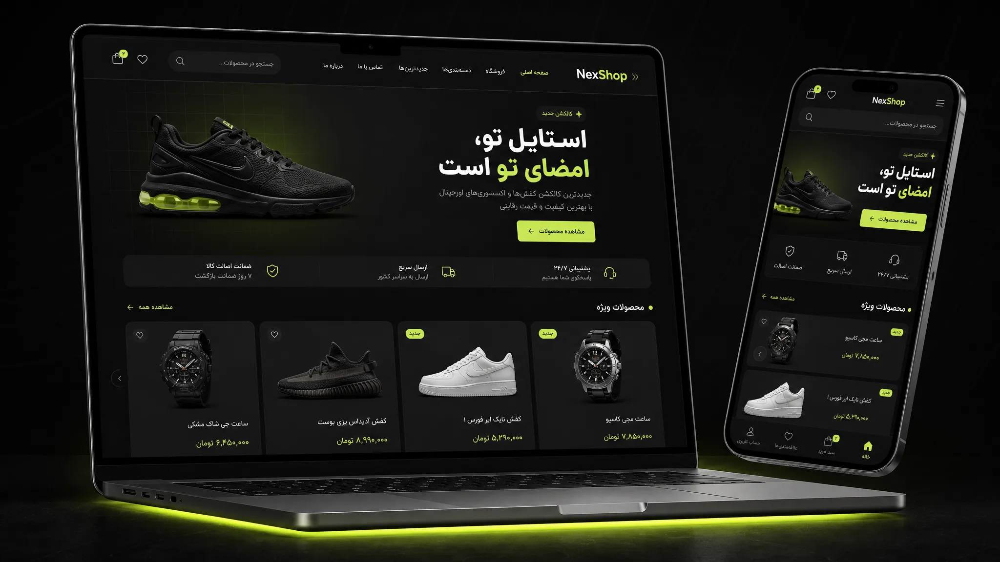

# NexShop — قالب فروشگاهی وردپرس (رایگان) 🛍

> 🌗 دارک‌مود + لایت‌مود • 🧩 فول المنتور • 🧬 چایلد تم • کاملاً راست‌چین 🇮🇷 — برای فروشگاه‌های ایرانی و بین‌المللی

## ✨ ویژگی‌ها (v2.0.0)

### جدید در نسخهٔ ۲.۰
- 🌗 **دارک‌مود و لایت‌مود کامل** — سیستم CSS Variables دوحالته، دکمهٔ سوییچ در هدر، ذخیرهٔ انتخاب کاربر (localStorage)، تشخیص خودکار تم سیستم (`prefers-color-scheme`)، بدون فلش در بارگذاری اولیه (FOUC-free) و تنظیم «حالت پیش‌فرض» در سفارشی‌ساز
- 🧩 **فول المنتور** — لوکیشن‌های کامل Theme Builder (هدر، فوتر، تک‌نوشته، آرشیو)، **دو ویجت اختصاصی: «محصولات نکس‌شاپ» و «دسته‌بندی‌های نکس‌شاپ»**، پل رنگی دارک/لایت برای ویجت‌های المنتور، استایل ادیتور هماهنگ و اعلان نصب داخل پیشخوان
- 🧬 **چایلد تم رسمی** (`nexshop-child/`) — آماده برای سفارشی‌سازی امن
- 🐞 رفع همهٔ موارد گزارش بررسی امنیت/کارایی/دسترس‌پذیری (جزئیات پایین 👇)

### ویژگی‌های اصلی
- ✅ پنل تنظیمات اختصاصی (نکس‌شاپ در پیشخوان)
- ✅ آماده اتصال به **زرین‌پال، زیبال، پی‌پینگ، Stripe و PayPal** (از طریق افزونه‌های درگاه ووکامرس) + تومان/ریال
- ✅ اتصال به **هوش مصنوعی + MCP + وب‌هوک** برای n8n و AI Agentها (REST API کاتالوگ با توکن + وب‌هوک سفارش امضاشده با **Retry خودکار**)
- ✅ **اسکیمای Organization، OG و تأیید گوگل/بینگ** داخل خود قالب (وقتی افزونهٔ سئو فعال نباشد)
- ✅ سبک و سریع: فونت وزیرمتن **خودمیزبان** (بدون CDN)، کش هوشمند بخش‌ها، انیمیشن‌های امن با IntersectionObserver

## 📦 نصب
1. کل ریپو را دانلود کنید (Code → Download ZIP) — داخل آن دو پوشهٔ `nexshop` (محتویات اصلی ریپو) و `nexshop-child` هست.
2. پوشهٔ تم را زیپ کنید (یا از [Releases](../../releases) زیپ آماده بگیرید) و در وردپرس: **نمایش → پوسته‌ها → افزودن → بارگذاری پوسته**
3. برای سفارشی‌سازی امن، همزمان `nexshop-child` را هم نصب و **چایلد را فعال** کنید.
4. تنظیمات: منوی **نکس‌شاپ** در پیشخوان + **نمایش → سفارشی‌سازی → تنظیمات نکس‌شاپ**

> سازگار با **WooCommerce** — تومان/ریال + درگاه‌های ایرانی و خارجی. نیاز: وردپرس ۶.۴+، PHP ۸.۰+

## 🧩 المنتور (فول پشتیبانی)
- با **Elementor Pro** هدر، فوتر، تک‌نوشته و آرشیو را از Theme Builder بسازید؛ قالب به‌طور خودکار جایگزین نسخهٔ پیش‌فرض می‌شود (همهٔ لوکیشن‌های core ثبت شده‌اند).
- با **Elementor رایگان**، دو ویجت اختصاصی نکس‌شاپ در دسترس است: **محصولات نکس‌شاپ** (تازه‌ترین/پرفروش/حراجی/ویژه + تعداد و ستون + کش) و **دسته‌بندی‌های نکس‌شاپ**.
- صفحه‌هایی که با المنتور ساخته می‌شوند تمام‌عرض و بدون عنوان/کانتینر قالب نمایش داده می‌شوند.
- ویجت‌های نکس‌شاپ از توکن‌های رنگ تم پیروی می‌کنند → هم‌اهنگ با دارک/لایت مود کار می‌کنند.
- اگر المنتور نصب نباشد، اعلان نصب یک‌کلیکی در پیشخوان نمایش داده می‌شود (قابل رد شدن).

## 🌗 دارک/لایت مود
- دکمهٔ سوییچ در هدر (خورشید/ماه) — انتخاب کاربر در `localStorage` ذخیره می‌شود.
- حالت پیش‌فرض سایت از **سفارشی‌سازی → رنگ‌بندی و حالت نمایش**: `خودکار (سیستم کاربر)` / `تیره` / `روشن`.
- کل رنگ‌ها با CSS Variables (`--nx-*`) تعریف شده‌اند؛ در چایلد تم با دو خط می‌توانید رنگ‌ها را عوض کنید.
- رویداد JS برای توسعه‌دهندگان: `window.addEventListener('nexshop:scheme-changed', e => e.detail.theme)`

## 🔧 پنل تنظیمات
منوی **نکس‌شاپ** در پیشخوان — کلید AI (+ حذف کامل کلید)، وب‌هوک، توکن API کاتالوگ، آنالیتیکس، تأیید Search Console، ویجت چت. لوگو/رنگ/متن‌ها/حالت نمایش از **سفارشی‌سازی**.

### API کاتالوگ و وب‌هوک
- `GET /wp-json/nexshop/v1/catalog` — نیازمند هدر `X-NexShop-Token: <توکن>` (یا `Authorization: Bearer …`). توکن از پنل قابل مشاهده است.
- وب‌هوک سفارش جدید فقط به آدرس **https** ارسال می‌شود و با هدر `X-NexShop-Signature: sha256=<HMAC>` امضا می‌شود. فقط پس از پاسخ موفق علامت‌گذاری می‌شود و در شکست **تا ۳ بار با فاصلهٔ افزایشی (۲/۵/۱۵ دقیقه) تلاش مجدد** می‌شود (یادداشت روی سفارش ثبت می‌شود). با فیلتر `nexshop_webhook_blocking` قابل تغییر است.
- آنالیتیکس برای مدیران بارگذاری نمی‌شود؛ برای اتصال به سیستم رضایت کاربر از فیلتر `nexshop_load_analytics` استفاده کنید.

## 🧬 چایلد تم
پوشهٔ `nexshop-child` را نصب و فعال کنید. استایل والد خودکار لود می‌شود؛ فقط در `style.css` چایلد بازنویسی کنید (نمونه‌های آماده داخل فایل هست). برای PHP هم `functions.php` چایلد جا دارد.

## 🖼 پیش‌نمایش

## 📄 مجوز
GNU GPL v3 (مطابق الزام قالب‌های وردپرس) — رایگان برای استفاده شخصی و تجاری. فونت وزیرمتن با مجوز SIL OFL (`assets/fonts/OFL.txt`). اگر به دردت خورد ⭐ بده ♻️

## 📝 تغییرات
### 2.0.0 — Full Elementor + Dark/Light
- **دارک/لایت مود**: سیستم کامل CSS Variables، سوییچ هدر، ذخیرهٔ انتخاب، تشخیص سیستم، تنظیم پیش‌فرض در سفارشی‌ساز، بدون FOUC
- **فول المنتور**: لوکیشن‌های کامل Theme Builder، ویجت‌های «محصولات» و «دسته‌بندی‌های نکس‌شاپ»، استایل ادیتور، اعلان نصب، پل رنگی
- **چایلد تم** رسمی با نمونه‌های آماده
- **رفع موارد بررسی فنی:**
  - تصویر هیرو اکنون با Attachment ID + `srcset` کامل (کنترل رسانه‌ای سفارشی‌ساز + سازگاری با URL قدیمی)
  - کش بخش‌ها با `woocommerce_scheduled_sales` هم پاک می‌شود → قیمت‌های فروش زمان‌بندی‌شده همیشه تازه
  - منوی موبایل دسترس‌پذیر شد: بستن با ESC، کلیک روی لینک، کلیک بیرون، قفل فوکوس
  - وب‌هوک: علامت‌گذاری «ارسال‌شده» فقط بعد از پاسخ موفق + Retry خودکار (۳ بار) + یادداشت سفارش
  - `searchform.php`: `post_type` با فیلتر `nexshop_search_post_type` قابل تغییر است
  - دکمه‌های ووکامرس بدون `!important` بازنویسی می‌شوند (سلکتورهای هم‌ارز)
  - امکان **حذف کامل کلید AI** از پنل
  - `content_width` و `add_editor_style()` اضافه شد
  - رشته‌های درگاه‌ها i18n شدند + فایل `nexshop.pot` برای ترجمه
  - بهداشت ریپو: حذف زیپ و فایل‌های اضافی، تبدیل بنر/دمو به WebP (۳.۵MB → ۲۴۴KB)، اصلاح Theme URI

### 1.1.0
- افزودن پشتیبانی المنتور (Theme Builder و صفحات تمام‌عرض)
- رفع خطای سینتکس در `index.php` (صفحهٔ وبلاگ/آرشیو پیش‌فرض با خطای fatal از کار می‌افتاد)
- رفع HTML خراب `<article>` (خروجی تکراری `post_class()`)
- فونت وزیرمتن خودمیزبان؛ حذف وابستگی به CDN
- انیمیشن‌های ورود فقط وقتی JS فعال است محتوا را پنهان می‌کنند؛ هیرو دیگر پنهان نمی‌شود (بهبود LCP)
- کش خودکار بخش‌های صفحهٔ اصلی و کاتالوگ
- امنیت: توکن برای API کاتالوگ، وب‌هوک امضاشده بدون ایمیل مشتری، عدم نمایش کلید AI در HTML، محدودسازی ذخیرهٔ اسکریپت ویجت به کاربران دارای `unfiltered_html`، اعتبارسنجی GA4/کدهای تأیید
