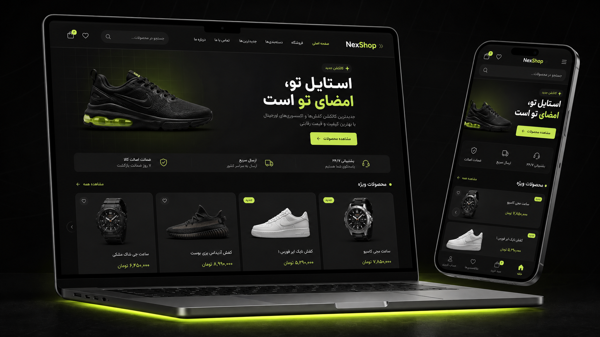
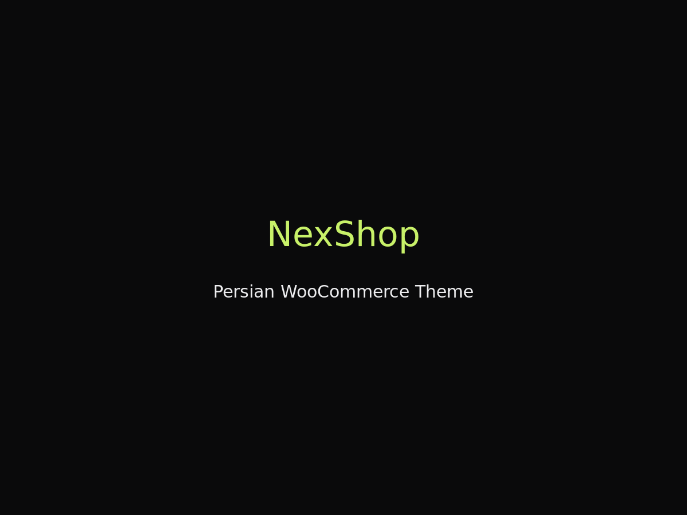

# NexShop — قالب فروشگاهی وردپرس (رایگان)

> 🔥 تیره • مینیمال • کاملاً راست‌چین 🇮🇷 — برای فروشگاه‌های ایرانی و بین‌المللی

## ✨ ویژگی‌ها
- ✅ پنل تنظیمات اختصاصی
- ✅ آماده اتصال به **زرین‌پال، زیبال، Stripe و PayPal** (از طریق افزونه‌های درگاه ووکامرس)
- ✅ **سازگار با المنتور** — لوکیشن‌های Theme Builder (هدر، فوتر، تک‌نوشته، آرشیو) و صفحات تمام‌عرض
- ✅ اتصال به **هوش مصنوعی + MCP + وب‌هوک** برای n8n و AI Agentها (REST API کاتالوگ با توکن + وب‌هوک سفارش امضاشده)
- ✅ **اسکیمای Organization، OG و تأیید گوگل/بینگ** داخل خود قالب (وقتی افزونهٔ سئو فعال نباشد)
- ✅ سبک و سریع: فونت وزیرمتن **خودمیزبان** (بدون CDN)، کش بخش‌های صفحهٔ اصلی، انیمیشن‌های امن
- ✅ تم تیره مینیمال با انیمیشن‌های نرم

## 📦 نصب
1. فایل `nexshop-theme-v1.1.0.zip` را دانلود کنید (از [Releases](../../releases))
2. وردپرس → نمایش → پوسته‌ها → افزودن → بارگذاری پوسته → انتخاب فایل زیپ
3. فعال‌سازی → تنظیمات از منوی **نکس‌شاپ** در پیشخوان وردپرس (و شخصی‌سازی ظاهر از نمایش → سفارشی‌سازی)

> سازگار با **WooCommerce** — تومان/ریال + درگاه‌های ایرانی و خارجی

## 🧩 المنتور
- با **Elementor Pro** می‌توانید هدر، فوتر، تک‌نوشته و آرشیو را از Theme Builder بسازید؛ قالب به‌طور خودکار جایگزین نسخهٔ پیش‌فرض می‌شود.
- صفحه‌هایی که با المنتور ساخته می‌شوند (از جمله صفحهٔ اصلی) تمام‌عرض و بدون عنوان/کانتینر قالب نمایش داده می‌شوند.
- با **Elementor رایگان** هم صفحه‌های جداگانه کار می‌کنند؛ هدر/فوتر قابل ویرایش نیاز به Pro دارد.

## 🔧 پنل تنظیمات
منوی **نکس‌شاپ** در پیشخوان — کلید AI، وب‌هوک، توکن API کاتالوگ، آنالیتیکس، تأیید Search Console، ویجت چت. لوگو/رنگ/متن‌ها از **نمایش → سفارشی‌سازی → تنظیمات نکس‌شاپ**.

### API کاتالوگ و وب‌هوک
- `GET /wp-json/nexshop/v1/catalog` — نیازمند هدر `X-NexShop-Token: <توکن>` (یا `Authorization: Bearer …`). توکن از پنل قابل مشاهده است.
- وب‌هوک سفارش جدید فقط به آدرس **https** ارسال می‌شود و با هدر `X-NexShop-Signature: sha256=<HMAC>` امضا می‌شود (راز امضا در پنل). ایمیل مشتری ارسال نمی‌شود؛ برای افزودن فیلد از فیلتر `nexshop_webhook_payload` استفاده کنید.
- آنالیتیکس برای مدیران بارگذاری نمی‌شود؛ برای اتصال به سیستم رضایت کاربر از فیلتر `nexshop_load_analytics` استفاده کنید.

## 🖼 پیش‌نمایش

## 📄 مجوز
GNU GPL v3 (مطابق الزام قالب‌های وردپرس) — رایگان برای استفاده شخصی و تجاری. فونت وزیرمتن با مجوز SIL OFL (`assets/fonts/OFL.txt`). اگر به دردت خورد ⭐ بده و ریتوییت کن ♻️

## 📝 تغییرات
### 1.1.0
- افزودن پشتیبانی المنتور (Theme Builder و صفحات تمام‌عرض)
- رفع خطای سینتکس در `index.php` (صفحهٔ وبلاگ/آرشیو پیش‌فرض با خطای fatal از کار می‌افتاد)
- رفع HTML خراب `<article>` (خروجی تکراری `post_class()`)
- فونت وزیرمتن خودمیزبان؛ حذف وابستگی به CDN
- انیمیشن‌های ورود فقط وقتی JS فعال است محتوا را پنهان می‌کنند؛ هیرو دیگر پنهان نمی‌شود (بهبود LCP)
- کش خودکار بخش‌های صفحهٔ اصلی و کاتالوگ
- امنیت: توکن برای API کاتالوگ، وب‌هوک امضاشده و غیرمسدودکننده بدون ایمیل مشتری، عدم نمایش کلید AI در HTML، محدودسازی ذخیرهٔ اسکریپت ویجت به کاربران دارای `unfiltered_html`، اعتبارسنجی GA4/کدهای تأیید
- حذف اسکیمای تکراری Product (ووکامرس خودش چاپ می‌کند) و OG/اسکیما در حضور افزونه‌های سئو
- حذف `wp_localize_script` بی‌مصرف (nonce و ajaxUrl)

## 🔗 لینک‌ها
- Issues همین ریپو برای پیشنهاد/باگ
- X: [@hellboy_code](https://x.com/hellboy_code)

---
ساخته شده با ❤️ توسط hellboy
